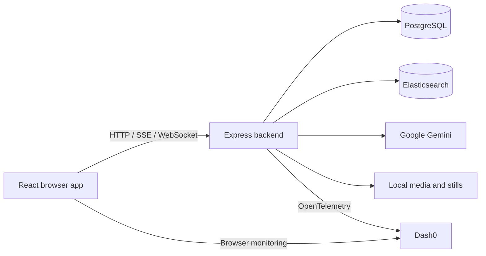

# Summit Thread

**Summit Thread is a real-time conference companion that makes presentations more accessible and easier to follow.** It turns a presentation into evolving topic threads, timestamped evidence, and important visual moments. Attendees can catch up after arriving late or stepping away, revisit an explanation, and ask private questions grounded in the talk—all while the presentation continues.

[Try the hosted app](https://summitthread.cnh.radarhq.io) · [Public source repository](https://github.com/kkhanhtrann/Summit-Thread) · [Cloud Native Hackathon](https://www.wemakedevs.org/hackathons/cnh)

Built for the WeMakeDevs Cloud Native Hackathon using **Gitar, Dash0, Elasticsearch, and Radar**. This public repository includes the application source, local setup, deployment manifests, and documented verification evidence.

## Contents

- [What Summit Thread does](#what-summit-thread-does)
- [Run locally](#run-locally)
- [Use the application](#use-the-application)
- [How we use the hackathon sponsors](#how-we-use-the-hackathon-sponsors)
- [Architecture](#architecture)
- [Development and verification](#development-and-verification)
- [Deployment](#deployment)
- [Documentation](#documentation)
- [Current limits](#current-limits)

## What Summit Thread does

| Capability | Experience |
| --- | --- |
| Shared presentation rooms | Presenters create a room and share an invitation link or eight-character code. Attendees follow the same recording playback. |
| Progressive captions | Finalized speech appears with source timestamps as the presentation advances. Interim recognition stays outside attendee history. |
| Evolving topic threads | Related ideas remain connected across the talk, with notes and evidence for each visit to a topic. |
| Catch-up navigation | Explore earlier topics and transcript passages without seeking shared playback or losing your reading position. Return to now when ready. |
| Visual moments | Completed video intervals can yield useful original stills, with descriptions, timestamps, and related spoken context. |
| Private Ask | Ask questions grounded in released speech and presenter materials. Answers cite their sources; conversation history stays in the current browser page. |
| Presenter materials | Add notes or text-based PDFs to support answers. Citations distinguish presenter materials from words actually spoken. |

Uploaded recordings are the documented walkthrough path. Camera intake is also implemented through an explicit presenter action; its hardware verification and deployment requirements are described under [current limits](#current-limits).

## Run locally

### Prerequisites

- **Node.js 24** and npm. The Node version is declared in [`.nvmrc`](.nvmrc).
- **Docker with Compose v2**, running locally, for PostgreSQL and Elasticsearch.
- **FFmpeg and FFprobe on `PATH`** for video-window analysis and still extraction. Recording validation also has a pinned bundled FFprobe; keep npm optional dependencies enabled.
- Available local ports **5185**, **3110**, **5435**, and **9203**.
- A current desktop Chrome or Firefox browser for uploaded-media audio capture. Browser and codec support varies; see [rooms and playback](docs/features/rooms-and-playback.md).

### 1. Clone and install

```sh
git clone https://github.com/kkhanhtrann/Summit-Thread.git
cd Summit-Thread
npm ci
npm run install:all
cp backend/.env.example backend/.env
cp web/.env.example web/.env.local
```

The root, backend, and frontend have separate committed lockfiles. The installation commands use those locked dependencies.

### 2. Configure the environment

The copied examples contain connection settings for the dedicated local Compose services. **Room creation, recording uploads, and playback work without AI or telemetry credentials.** To enable transcription, topic generation, visual analysis, and generated answers, set `GEMINI_API_KEY` in `backend/.env` before starting the app.

| File | Variable | Purpose |
| --- | --- | --- |
| `backend/.env` | `DATABASE_URL` | PostgreSQL connection; the example targets the local database on port 5435. |
| `backend/.env` | `ELASTICSEARCH_URL` | Search connection; the example targets `http://127.0.0.1:9203`. |
| `backend/.env` | `GEMINI_API_KEY` | Backend-only credential for AI features. Requires access and quota for the configured models. |
| `backend/.env` | `GEMINI_TEXT_MODEL`, `GEMINI_LIVE_TRANSCRIPTION_MODEL`, `GEMINI_VISUAL_MODEL` | Optional model overrides for text generation, live transcription, and visual review. Defaults are supplied in the example. |
| `backend/.env` | `DASH0_BACKEND_TOKEN`, `DASH0_OTLP_ENDPOINT`, `DASH0_DATASET` | Optional backend telemetry export to your Dash0 dataset. |
| `web/.env.local` | `VITE_DASH0_BROWSER_TOKEN`, `VITE_DASH0_OTLP_ENDPOINT`, `VITE_DASH0_DATASET` | Optional browser monitoring using a separate, restricted ingestion token. |

See the complete [backend](backend/.env.example) and [frontend](web/.env.example) examples for host, origin, and other settings. Never place a Gemini key or backend token in a `VITE_` variable: Vite includes those values in browser assets. Restart the development processes after changing configuration. Both real environment files are ignored by Git.

### 3. Start services and the application

```sh
npm run services:up
npm run db:deploy
npm run dev
```

`services:up` waits for the dedicated PostgreSQL and Elasticsearch containers to become healthy. `db:deploy` applies the committed database migrations. `dev` starts the API and web development servers together in the foreground.

| Service | Local address |
| --- | --- |
| Web application | <http://127.0.0.1:5185> |
| Presenter workspace | <http://127.0.0.1:5185/presenter> |
| Backend API | <http://127.0.0.1:3110/api> |
| PostgreSQL | `127.0.0.1:5435` |
| Elasticsearch | <http://127.0.0.1:9203> |

Verify dependencies from a second terminal:

```sh
curl --fail http://127.0.0.1:3110/api/health/ready
```

A ready application returns `{"status":"ready"}`. The separate `/api/health/live` endpoint checks only the API process.

Stop the app with **Ctrl+C**, then stop its local services with:

```sh
npm run services:down
```

This retains the Compose volumes. The dedicated Compose project is `summit-thread-foundation-local`; avoid database resets or volume removal when retaining room data.

## Use the application

1. Open `/presenter`, name the presentation, and create a room.
2. Copy the invitation into a second browser window to join as an attendee.
3. Upload a team-owned or consented audio/video recording and choose a 1, 3, 5, or 10 minute analysis interval. Uploads are limited to **300 MiB**; format details are in [rooms and playback](docs/features/rooms-and-playback.md).
4. Optionally add notes or a text-based PDF in **Talk materials**. Scanned PDFs have no OCR support.
5. Start playback. With Gemini configured, finalized captions appear progressively and feed topic analysis. Video review runs after completed intervals; an interval may legitimately produce no still.
6. As an attendee, explore **Topics**, read the **Transcript**, or use **Ask**. Follow evidence citations and return to now without changing shared playback. Enable sound if the browser blocks autoplay.

Fresh rooms start empty. No recordings or participant content are bundled with the application. For a complete two-browser rehearsal, recovery checks, and recording guidance, follow the [walkthrough](docs/walkthrough.md).

## How we use the hackathon sponsors

The [Cloud Native Hackathon](https://www.wemakedevs.org/hackathons/cnh) brings together code review, observability, Kubernetes operations, and search. Summit Thread uses each of these in its development or running application.

### Gitar — review and CI diagnosis

Gitar reviews our feature pull requests using repository-specific [review instructions](.gitar/review/instructions.md), a [privacy rule](.gitar/rules/privacy.md), and [fix criteria](.gitar/config/apply.md). The instructions cover architecture boundaries, released-caption evidence, private questions, and credential handling. Required CI and team review retain control over merges.

This workflow produced real fixes. On [foundation PR #7](https://github.com/kkhanhtrann/Summit-Thread/pull/7), Gitar diagnosed URL privacy leakage and lost development-process exit statuses; its [auto-applied correction](https://github.com/kkhanhtrann/Summit-Thread/commit/cf3290b0a0ac95ba5f5803a5bc55aa892ccc7aa8) preserved the regression tests and was followed by [passing CI](https://github.com/kkhanhtrann/Summit-Thread/actions/runs/42664619372). On [Private Ask PR #13](https://github.com/kkhanhtrann/Summit-Thread/pull/13), its findings led to fixes for refresh-driven focus theft and repeated transcript reads.

### Dash0 — operational visibility and recovery

The backend exports OpenTelemetry **traces, structured logs, and metrics** to Dash0. Instrumentation covers HTTP requests, PostgreSQL, Elasticsearch, indexing, answer generation, and visual review. The browser SDK adds navigation, requests, errors, and web vitals, with session recording disabled. Operational counts and fixed failure categories support diagnosis while content-bearing fields and URL values are filtered.

We used Dash0's **Agent0** to inspect real application behavior. During a controlled local Elasticsearch interruption, it traced failed readiness and Ask requests, indexing retries, and successful recovery. Playback updates continued; after search recovered, the same question could be retried successfully with citations. The [verification record](docs/development-tools.md#integrated-verification-issue-6) documents the observed time window, results, and privacy-check limits. These observations used the signed-in Agent0 UI; they are separate from Dash0 MCP registration.

### Elasticsearch — retrieval behind grounded answers

Elasticsearch powers the retrieval path for **Private Ask**, searching released captions with their topic context and searching presenter-material passages in a separate index. It also supplies relevant presenter background for topic vocabulary. The implementation uses **keyword relevance**, with room filters and PostgreSQL-derived allowed IDs.

The backend reloads canonical evidence from PostgreSQL before generating answers, so stale, foreign-room, or unreleased index documents cannot become citations. Caption release and indexing jobs commit in one database transaction; a durable worker retries search writes after an outage. The index can be rebuilt from committed records without retranscribing a recording. See [Private Ask](docs/features/private-ask.md) and [talk materials](docs/features/talk-materials.md) for contracts and recovery tests.

### Radar — Kubernetes deployment and troubleshooting

Summit Thread runs on the team's Radar-connected Kubernetes cluster in namespace `team-summitthread`. The deployment includes the application, CloudNativePG-managed PostgreSQL, and Elasticsearch. Argo CD reconciles the manifests in [`deploy/`](deploy) from `main`, while GitHub Actions publishes application images and opens reviewed deployment-pin pull requests.

We used Radar's **UI and MCP connection** to inspect workload health, logs, rollout state, and the deployed image. During recovery, a stale Elasticsearch pod was still running an older template and failing on data-directory permissions. Replacing that failed pod after checking the corrected StatefulSet restored search and application readiness while preserving its volume and database. [Issue #21](https://github.com/kkhanhtrann/Summit-Thread/issues/21), [deployment fix PR #23](https://github.com/kkhanhtrann/Summit-Thread/pull/23), and the [deployment runbook](docs/radar-deployment.md) record the work. A hosted Radar AI investigation is not yet recorded as submission evidence.

## Architecture

Summit Thread has two TypeScript applications: a **React/Vite frontend** and an **Express backend modular monolith**. The backend owns validation, application behavior, persistence, search, AI providers, and operational instrumentation.



PostgreSQL is the authority for released captions, topics, room revisions, materials, and indexing jobs. Elasticsearch is rebuildable retrieval infrastructure. Playback, transcription, topic work, and visual review run independently. Only finalized, released speech enters attendee history and spoken-evidence retrieval.

Google Gemini integrations stay on the backend: the Vercel AI SDK Google provider handles answers and topics; Google's GenAI SDK handles live transcription and isolated visual windows. Backend OpenAPI owns implemented HTTP contracts, and the web app consumes generated API types.

```text
backend/
  src/features/        Sessions, transcription, search, and private Ask
  src/platform/        AI adapters, media, logging, and telemetry
  prisma/             Durable schema and committed migrations
  openapi.json        Backend-owned HTTP contract
web/
  src/features/        Presenter, attendee reader, Ask, and media interactions
  src/lib/api/         Shared transport and generated API types
  src/shared/          UI components and design tokens
deploy/               Kubernetes application and data-service manifests
argocd/               Argo CD application configuration
.gitar/               Review instructions, rules, and fix criteria
.github/workflows/    CI and image publishing
docs/                 Architecture, features, walkthrough, and operations
```

See [architecture](docs/architecture.md) for transaction boundaries, source clocks, event reconciliation, and feature ownership.

## Development and verification

With the local services running and migrations applied:

```sh
npm run check
```

This regenerates API types, checks TypeScript, runs static import-boundary and behavior tests, and builds both applications. Database tests use isolated fixture schemas. Deterministic test content is synthetic; provider credentials are not required for the normal check.

| Command | Purpose |
| --- | --- |
| `npm run services:logs` | Follow the dedicated PostgreSQL and Elasticsearch logs. |
| `npm run contracts:generate` | Regenerate web API types after backend contract changes. |
| `npm run db:migrate` | Create/apply development migrations when changing the schema. |
| `npm --prefix backend run search:rebuild` | Requeue released captions and ready materials for indexing. |
| `npm --prefix backend run test:search:integration` | Run real PostgreSQL/Elasticsearch recovery tests against a separate, disposable test database; follow the [isolation instructions](docs/features/private-ask.md#verification). |

CI also checks migration drift, container media tools, search recovery, and runtime readiness. Follow [development](docs/development.md) for migration/shadow-database setup and safe recovery, and [AGENTS.md](AGENTS.md) for contribution conventions. Submit changes through reviewed pull requests with passing required checks.

## Deployment

The hosted hackathon app is available at **<https://summitthread.cnh.radarhq.io>**. Its release flow is:

1. Merge reviewed application changes into `main`.
2. **Deploy to Radar** builds and publishes a commit-tagged image to GitHub Container Registry and opens a deployment PR.
3. Approve workflows to run if GitHub holds that PR's CI, then review and merge the image-pin change after required checks pass.
4. Argo CD syncs `deploy/`, and Kubernetes rolls out the selected image.

**A new commit on `main` does not release its application image until the deployment-pin PR is merged.** Argo being synced proves that manifests match Git; confirm the running image and readiness to verify a release.

Use the [Radar deployment runbook](docs/radar-deployment.md) for package access, GitHub Actions settings, runtime Secrets, health checks, and recovery. The application runs as one backend process/replica with ephemeral uploaded-media storage in this environment.

## Documentation

| Guide | Covers |
| --- | --- |
| [Walkthrough](docs/walkthrough.md) | Two-browser demo, recovery rehearsal, and evidence handling |
| [Development](docs/development.md) | Local resources, commands, migrations, and CI |
| [Architecture](docs/architecture.md) | Ownership, persistence, contracts, and event flow |
| [Rooms and playback](docs/features/rooms-and-playback.md) | Upload formats, source clocks, transcription, and camera lifecycle |
| [Topic threads](docs/features/topic-threads.md) | Topic transitions, evidence, catch-up, and retry behavior |
| [Visual moments](docs/features/visual-moments.md) | Elapsed-window review, original stills, and release rules |
| [Private Ask](docs/features/private-ask.md) | Retrieval, typed citations, privacy, and search recovery |
| [Talk materials](docs/features/talk-materials.md) | Notes, PDF extraction, indexing, and material citations |
| [Development tools](docs/development-tools.md) | Gitar and Dash0 setup, observed investigations, and verification limits |
| [Radar deployment](docs/radar-deployment.md) | Kubernetes setup, release approvals, health, and recovery |
| [Frontend design](docs/features/frontend-design.md) | Design tokens, layouts, accessibility checks, and labeled screenshots |