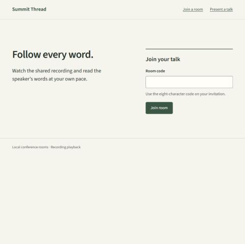
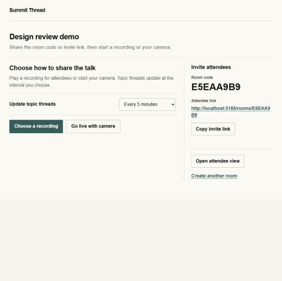
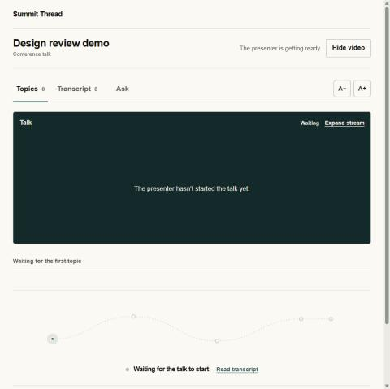
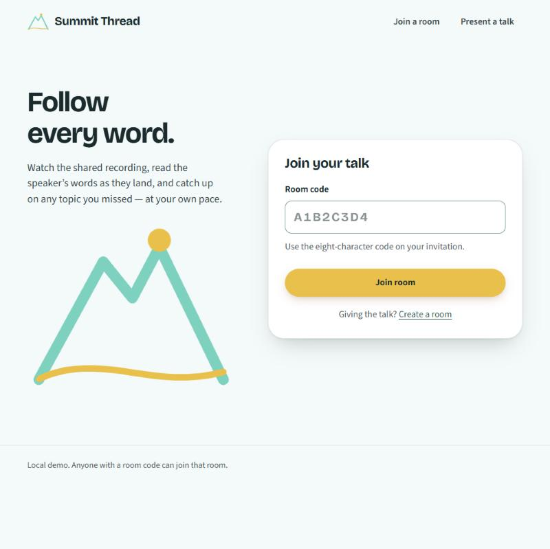
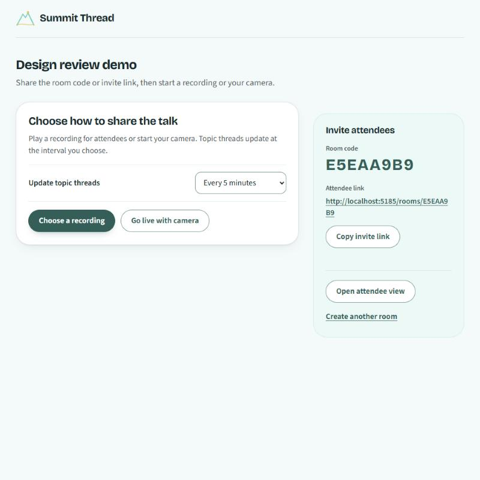
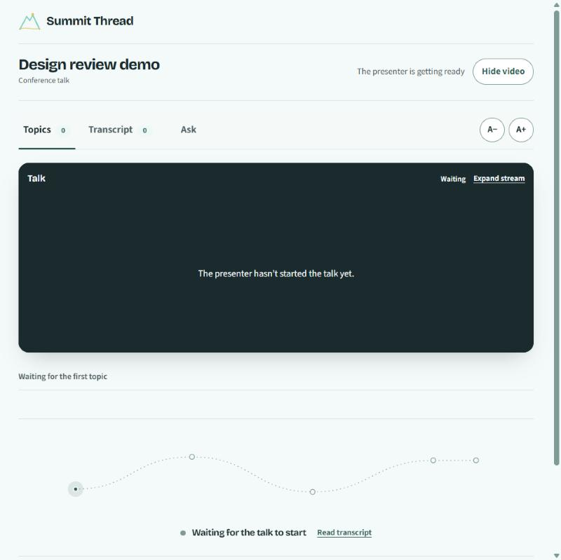
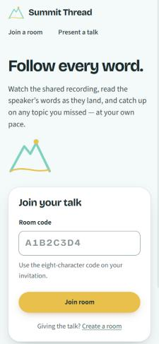
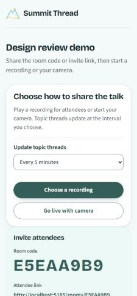
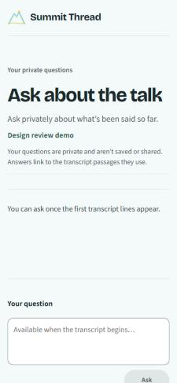

# Frontend design

The web app follows the Summit Thread logo: a teal mountain line, an amber sun, and an amber thread. The redesign (issue #18) is frontend only. It changes styles, tokens, fonts, the logo asset, and presentation markup. Backend code, OpenAPI, generated API types, API adapters, state logic, and telemetry are unchanged.

## Principles

- **Amber means "now".** It marks live status, the newest transcript line, the current topic, and the main step into a talk. It is not used for decoration.
- **Teal is the brand; lagoon carries it into text.** Logo teal decorates lines and fills. The darker lagoon shade is used for text, buttons, and focus.
- **One bold moment.** The entry screen draws the logo once on load. Everything else stays quiet: white surfaces, generous space, and rounding that follows hierarchy.
- **Reading first.** Captions and answers use Source Sans 3 at comfortable sizes and line lengths. Display type is reserved for titles and identity.

## Brand colors and contrast

All values live in `web/src/shared/styles/tokens.css` as `--st-*` custom properties.

| Token | Value | Role | Contrast |
| --- | --- | --- | --- |
| `--st-teal` | `#2DD4BF` | Logo teal: lines, fills, decoration | 1.86:1 on white, so never used as text on light surfaces; 8.12:1 on night |
| `--st-lagoon` | `#0B5F59` | Text, links, primary buttons, focus | 7.51:1 on white; white on lagoon 7.51:1 |
| `--st-amber` | `#FBBF24` | "Now" fills and markers | 1.67:1 on white, so never used as text on light surfaces; night text on amber 9.05:1 |
| `--st-ember` | `#8A4B00` | Amber-family text | 6.80:1 on white |
| `--st-night` | `#0E2A2E` | Ink and dark media panels | 15.12:1 on white |
| `--st-muted` | `#4A6266` | Secondary text | 6.50:1 on white, 6.14:1 on mist |
| `--st-mist` | `#F2FAF9` | Page ground | — |
| `--st-line-strong` | `#6E9C98` | Field borders | 3.06:1 on white (UI boundary) |
| `--st-error` | `#B42318` | Errors | 6.57:1 on white |

Every text pairing used in the interface meets WCAG AA. Body text is ≥ 4.5:1, and field boundaries and focus indicators are ≥ 3:1.

## Typography

- **Bricolage Grotesque** (`@fontsource-variable/bricolage-grotesque` 5.3.0, optical-size axis) for the wordmark, page and section titles, and room codes. It was chosen over the issue's suggested candidates (Plus Jakarta Sans, Manrope, Outfit). Its slightly irregular grotesque shapes give the brand a recognizable voice, while the optical-size axis keeps small titles crisp.
- **Source Sans 3** (already installed) for body, UI, captions, and answers. It is highly legible for long reading at enlarged sizes.
- Both are self-hosted from pinned packages; no external font requests.
- Page titles use a fluid `clamp()` scale. Room codes and timestamps use tabular numbers.

The previous reader styles named `"Source Sans 3"`, but the installed package registers `"Source Sans 3 Variable"`. Those screens had silently fallen back to the system font; the tokens now use the correct family names.

## Structure and patterns

- **Tokens:** `tokens.css` is loaded once in `main.tsx`. `conference-experience.css` (presenter and reader) and `private-chat.css` map their semantic roles (`--color-paper`, `--color-accent`, and so on) onto the brand tokens.
- **Brand layer:** the final block of `conference-experience.css` holds the redesign's overrides, placed last in the scope so it wins over earlier layers.
- **Logo:** `web/public/favicon.svg` and the `SummitLogo` and `BrandMark` components in `web/src/shared/ui/BrandMark.tsx`. `BrandMark` keeps the accessible name "Summit Thread home".
- **Shape:** panels 28px, cards 18px, controls 12px, chips 8px; buttons are pills. Shadows are tinted with night.
- **Screens:**
  - Join: headline and drawn logo, with a raised join card and an amber "Join room" button.
  - Presenter: a white workflow card and a teal-tinted invite panel with a large room code.
  - Reader: a rounded night media panel; "Live" turns amber. The newest transcript line has an amber marker; topic cards are white, and the current topic gets an amber ring.
  - Private Ask: question and answer bubbles.
  - Empty topic trail: a teal path with an amber "now" point.
- **Labels:** sentence case. The old tracked all-caps labels were removed.

## Motion

- **Entry:** the logo's mountain line draws, then the thread, then the sun rises, once on load (about 2 seconds).
- **Interactions:** buttons and cards respond to hover and press within 140–240 ms. Live indicators keep their existing pulse.
- **Reduced motion:** the drawing is shown complete, and transitions are switched off. The reader's existing global reduced-motion rule also stays in place.

## Responsive behavior

- Entry layouts collapse to one column below 800px.
- On phones, the logo drawing shrinks to a small accent so the join card stays above the fold.
- The presenter workspace stacks its workflow card above the invite panel, and buttons span the width.
- No horizontal scrolling was measured at 375px on the join, presenter, reader, and private Ask screens.
- None was measured at 768px on those screens either, including with the root font size doubled to 200%.

## Accessibility checks performed

- Contrast for every token pairing in the table above, computed with the WCAG relative-luminance formula.
- Keyboard focus reaches the room-code field; focus shows a lagoon border plus a 4px glow ring, confirmed through computed styles.
- The invalid-code error renders in error red and stays linked to the field through `aria-describedby`.
- Existing behavior tests (74) pass unchanged, covering roles, names, dialogs, and focus return.
- The logo is decorative (`aria-hidden`) wherever visible text names it.

## Screenshots

Before the redesign (captured at reduced scale):

| Join | Presenter | Reader |
| --- | --- | --- |
|  |  |  |

After, desktop:

| Join | Presenter | Reader |
| --- | --- | --- |
|  |  |  |

After, 375px mobile:

| Join | Presenter | Private Ask |
| --- | --- | --- |
|  |  |  |

All screenshots use a synthetic demo room ("Design review demo") with no recording or participant content.

## Verification

```sh
npm --prefix web run typecheck
npm run test:boundaries
npm --prefix web test
npm --prefix web run build
```

Bundle impact, measured against the pre-redesign build of the same commit:
- JS and CSS: 109.8 → 112.1 KB gzipped (+2.3 KB).
- Font files: 149 → 267 KB on disk, across all unicode-range subsets. Browsers download only the subsets a page uses.

## Known limits

- The newest-caption marker, topic cards, visual-moment gallery, and Ask answer bubbles are styled but were not seen with live content. That needs an uploaded recording and a configured `GEMINI_API_KEY`, which this check did not use.
- Reduced motion was verified by reading the CSS rules, not by emulating the OS setting in a browser.
- The 200% check doubled the root font size rather than using the browser's own text-size or zoom setting.
- A dark theme is optional in the issue and was not built.
