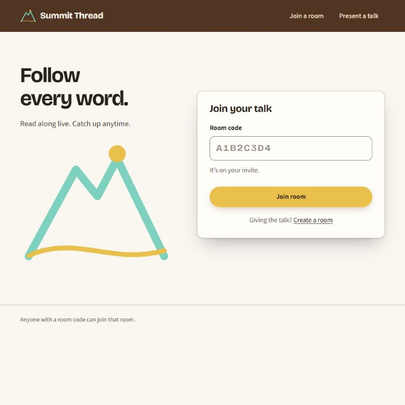
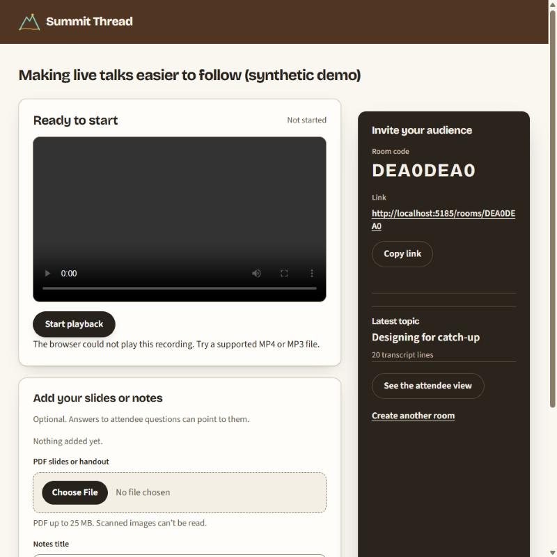
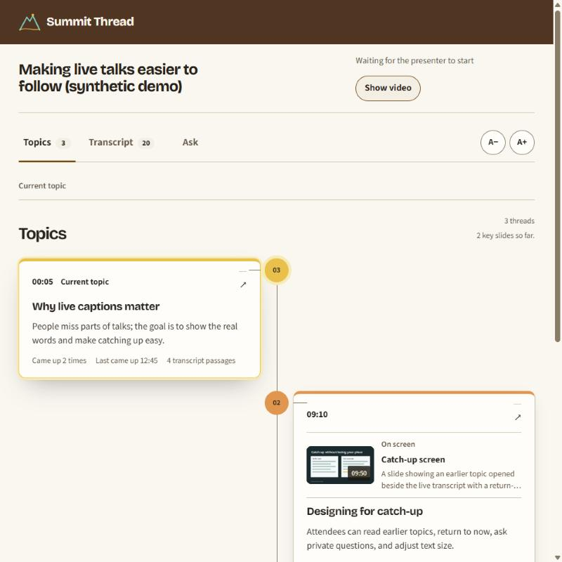

# Frontend design

The web app follows the Summit Thread logo: a teal mountain line, an amber sun, and an amber thread. The first redesign (issue #18) set up tokens, fonts, the logo, and the layouts. Issue #24 replaced its all-teal palette with a warm one and rewrote the customer-facing copy. Both are frontend only: backend code, OpenAPI, generated API types, API adapters, state logic, and telemetry are unchanged.

## Principles

- **Warm ground, no tint.** A light cream page, warm-white panels, and espresso text. No background or text color is green, teal, blue, or grey.
- **Coffee top bar.** One dark brown bar runs the full width of every screen and carries the logo.
- **Amber means "now".** It marks live status, the newest transcript line, the current topic, and the main step into a talk. It is not used for decoration.
- **Teal stays in the logo.** Logo teal appears in the logo, the entry drawing, the empty-topic trail, and as one of the topic accents. It is never a surface or text color.
- **Topics get their own colors.** Each topic thread keeps one accent (teal, coral, tangerine, or pink) on its marker and top edge, chosen from first-appearance order so colors never shift when topics reorder.
- **Clear component edges.** Panels sit on the page with visible borders and shadows; one dark espresso block per screen (invite panel, video panel, your questions in Ask) adds contrast.
- **Reading first.** Captions and answers use Source Sans 3 at comfortable sizes and line lengths. Display type is reserved for titles and identity.

## Colors and contrast

All values live in `web/src/shared/styles/tokens.css` as `--st-*` custom properties.

| Token | Value | Role | Contrast |
| --- | --- | --- | --- |
| `--st-bar` | `#5A3420` | Coffee top bar | Cream text on it 10.14:1; logo teal 5.79:1; logo amber 6.46:1 |
| `--st-canvas` | `#FBF7F0` | Page ground | Ink 14.64:1; muted 6.20:1 |
| `--st-surface` | `#FFFDF9` | Panels and cards | Card border `#D9C8AE` 1.61:1 (decorative edge) |
| `--st-ink` | `#2A221B` | Text and primary buttons | Cream button text on ink 15.16:1 |
| `--st-muted` | `#6A5A49` | Secondary text | 6.47:1 on panels |
| `--st-line-strong` | `#8F7D66` | Field borders | 3.85:1 on panels (UI boundary) |
| `--st-focus` | `#8A4B00` | Focus ring and selected tab | 6.37:1 on the page |
| `--st-dark` | `#2E241C` | Video panel, invite panel, question bubbles | Cream text 13.40:1; dim text 7.91:1 |
| `--st-amber` | `#FBBF24` | "Now" fills and the join button | Ink text on amber 9.37:1; never used as text on light surfaces |
| `--st-ember` | `#8A4B00` | Amber-family text | 6.30:1 on amber-50 |
| `--st-accent-1…4` | teal `#2DD4BF`, coral `#FB7185`, tangerine `#FB923C`, pink `#F472B6` | Topic markers and edges | Ink numbers on each 5.8–8.4:1 |
| `--st-error` | `#B42318` | Errors | 6.37:1 on panels |

Every text pairing used in the interface meets WCAG AA. Body text is ≥ 4.5:1, and field boundaries and focus indicators are ≥ 3:1.

## Copy

Customer-facing copy follows what comparable products do: a short benefit-first headline, verb-first buttons of one to three words, and at most one short sentence of help.

- No subtitle that restates its heading or explains how the system works.
- No joined labels like `A · B`; use a short phrase or a second sentence instead.
- Speak to the person in plain words ("Read along live. Catch up anytime.", "Only you see your questions.").

## Typography

- **Bricolage Grotesque** (`@fontsource-variable/bricolage-grotesque` 5.3.0, optical-size axis) for the wordmark, page and section titles, and room codes. It was chosen over the issue's suggested candidates (Plus Jakarta Sans, Manrope, Outfit). Its slightly irregular grotesque shapes give the brand a recognizable voice, while the optical-size axis keeps small titles crisp.
- **Source Sans 3** (already installed) for body, UI, captions, and answers. It is highly legible for long reading at enlarged sizes.
- Both are self-hosted from pinned packages; no external font requests.
- Page titles use a fluid `clamp()` scale. Room codes and timestamps use tabular numbers.

The previous reader styles named `"Source Sans 3"`, but the installed package registers `"Source Sans 3 Variable"`. Those screens had silently fallen back to the system font; the tokens now use the correct family names.

## Structure and patterns

- **Tokens:** `tokens.css` is loaded once in `main.tsx`. `conference-experience.css` (presenter and reader) and `private-chat.css` map their semantic roles (`--color-paper`, `--color-accent`, and so on) onto the brand tokens.
- **Brand layer:** the final block of `conference-experience.css` holds the redesign's overrides, placed last in the scope so it wins over earlier layers.
- **Logo:** `web/public/favicon.svg` and the `SummitLogo` and `BrandMark` components in `web/src/shared/ui/BrandMark.tsx`. `BrandMark` keeps the accessible name "Summit Thread home".
- **Shape:** panels 14px, cards 12px, controls 12px, chips 8px; buttons are pills. Shadows are tinted with espresso.
- **Top bar:** painted with a `border-image` outset so it reaches both viewport edges without extra markup.
- **Screens:**
  - Join: headline and drawn logo, with a raised join card and an amber "Join room" button.
  - Presenter: a warm-white workflow card, a talk-materials card for slides and notes, and a dark espresso invite panel with a large room code.
  - Reader: an espresso media panel; "Live" turns amber. The newest transcript line has an amber marker. Topic cards carry their thread's accent, and the current topic gets an amber ring.
  - Private Ask: dark question bubbles and warm-white answer bubbles.
  - Empty topic trail: a teal path with an amber "now" point.
- **Labels:** sentence case. The old tracked all-caps labels were removed.

## Motion

- **Entry:** the logo's mountain line draws, then the thread, then the sun rises, once on load (about 2 seconds).
- **Interactions:** buttons and cards respond to hover and press within 140–240 ms. Live indicators keep their existing pulse.
- **Reduced motion:** the drawing is shown complete, and transitions are switched off. The reader's existing global reduced-motion rule also stays in place.

## Responsive behavior

- Entry layouts collapse to one column below 800px.
- On phones, the logo drawing shrinks to a small accent so the join card stays above the fold.
- The presenter workspace stacks its workflow card above the invite panel, and buttons span the width.
- No horizontal scrolling was measured at 375px on the join, presenter, reader, and private Ask screens.
- None was measured at 768px on those screens either, including with the root font size doubled to 200%.

## Accessibility checks performed

- Contrast for every token pairing in the table above, computed with the WCAG relative-luminance formula.
- Keyboard focus reaches the room-code field; focus shows a ring plus a 4px glow, confirmed through computed styles. Inside the coffee bar the ring is cream.
- The invalid-code error renders in error red and stays linked to the field through `aria-describedby`.
- All 82 web behavior tests pass, covering roles, names, dialogs, and focus return. Six assertions were updated only where wording changed.
- The logo is decorative (`aria-hidden`) wherever visible text names it.

## Screenshots

Current design (issue #24), desktop:

| Join | Presenter | Reader |
| --- | --- | --- |
|  |  |  |

The presenter and reader shots use a seeded synthetic demo room with no real recording, so the video area is empty.

History. Before the first redesign (captured at reduced scale):

| Join | Presenter | Reader |
| --- | --- | --- |
|  |  |  |

First redesign (issue #18, teal palette, since replaced), desktop:

| Join | Presenter | Reader |
| --- | --- | --- |
|  |  |  |

First redesign, 375px mobile:

| Join | Presenter | Private Ask |
| --- | --- | --- |
|  |  |  |

All screenshots use a synthetic demo room ("Design review demo") with no recording or participant content.

## Verification

```sh
npm --prefix web run typecheck
npm run test:boundaries
npm --prefix web test
npm --prefix web run build
```

Bundle impact, measured against the pre-redesign build of the same commit:
- JS and CSS: 109.8 → 112.1 KB gzipped (+2.3 KB).
- Font files: 149 → 267 KB on disk, across all unicode-range subsets. Browsers download only the subsets a page uses.

## Known limits

- The newest-caption marker, topic cards, visual-moment gallery, and Ask answer bubbles are styled but were not seen with live content. That needs an uploaded recording and a configured `GEMINI_API_KEY`, which this check did not use.
- Reduced motion was verified by reading the CSS rules, not by emulating the OS setting in a browser.
- The 200% check doubled the root font size rather than using the browser's own text-size or zoom setting.
- A dark theme is optional in the issue and was not built.
- Mobile screenshots for the warm palette were not re-captured; the layouts are unchanged from the first redesign.
